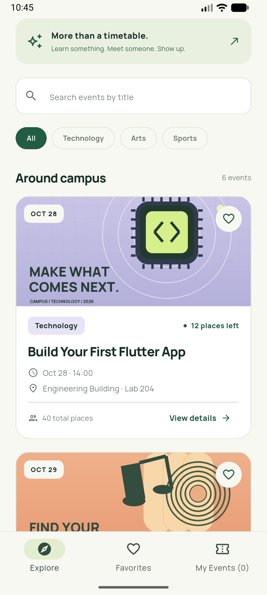
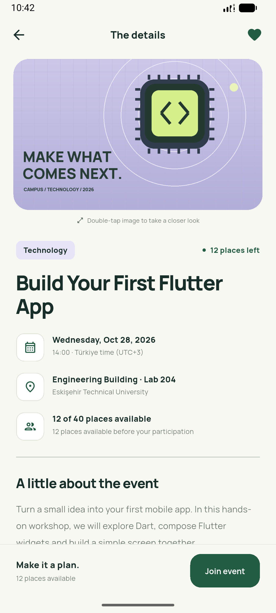
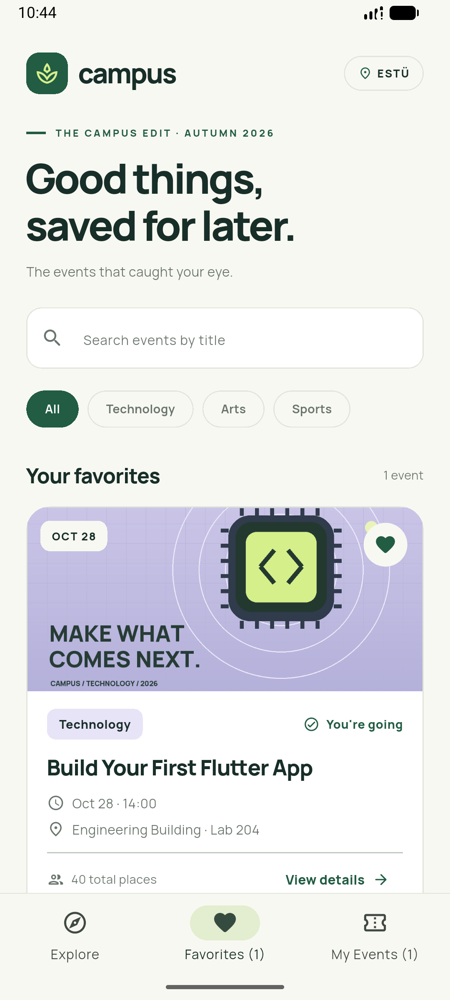
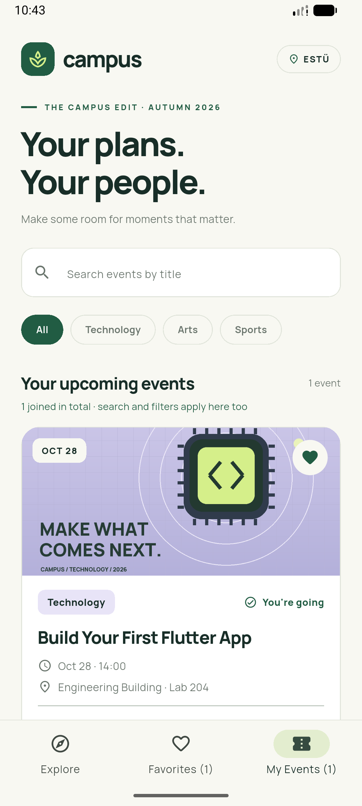

# Campus · Event Explorer

An offline Flutter application for **BIM493 – Mobile Programming I, Assignment #1**. Discover fictional campus events, save favorites and manage participation.

## Team

Team responsibilities are listed below.

| Member | Full name | Student ID | Responsibilities |
| --- | --- | --- | --- |
| 1 | Ufuk Özkan | 10075729720 | Event data and model; Explore cards; combined title search and category filters; participation/capacity rules; logic tests and Android setup verification. |
| 2 | Mert Can Kalınlıoğlu | 12331354158 | Details and enlarged-image navigation; Favorites/My Events presentation; join/cancel confirmation dialogs; local assets, font and styling; widget-flow checks, README and screenshot evidence. |

## Required toolchain

Use **Flutter 3.47.6, Stable channel**. The app was built and tested with this version. No Beta or Main channel is used.

Actual `flutter --version` output:

```text
Flutter 3.47.6 • channel stable • https://github.com/flutter/flutter.git
Framework • revision 5fc346839b (3 weeks ago) • 2026-09-30 15:02:49 -0700
Engine • hash b8c8d3d8d5d0095127057f8a29ca8cc53da2167c (revision 692136cb65) (22 days ago) • 2026-09-30 00:56:59.000Z
Tools • Dart 3.13.5 • DevTools 2.60.0
```

Android builds use the standard Flutter compile/target SDK settings and **NDK 30.0.16248370**, pinned in `android/app/build.gradle.kts`. Install this NDK through Android Studio → SDK Manager → SDK Tools → Show Package Details if it is not already available. Android SDK Platform 36 and Build-Tools 36.0.0 were installed on the verification machine. The tested emulator is Medium Phone, API 37.0. Java comes from Android Studio's bundled JDK.

## Run

From the repository root, run `cd hw1`, or open the `hw1` folder containing `pubspec.yaml` in VS Code. Install the Flutter extension by Dart Code, then run these commands from the project folder:

```sh
flutter --version
flutter pub get
flutter emulators
flutter emulators --launch Medium_Phone_API_37.0
flutter devices
flutter run -d emulator-5554
```

The emulator ID above belongs to the verification machine. Use your own emulator/device ID from `flutter devices` if different. A physical Android phone with USB debugging also works.

For a quick browser preview:

```sh
flutter run -d chrome
```

To build an Android APK:

```sh
flutter build apk --release
```

The APK is generated at `build/app/outputs/flutter-apk/app-release.apk`. The release build uses the template's debug signing key for coursework installation; no store publishing key is included.

## Features and interaction guide

- Six events in Technology, Arts and Sports, each with a unique ID, title, category, date/time, venue, description, bundled image, capacity and initial availability. All event dates are after October 25, 2026.
- Scrollable Explore cards show images, essential information, availability, favorites and View details.
- Title search ignores surrounding spaces and letter case. All/Technology/Arts/Sports filters combine with the title search. A result count and clear controls are provided.
- Explore, Favorites and My Events share the same search and category settings. Switching tabs does not reset them. My Events shows the total joined count independently of the filtered result count.
- Favorite buttons on cards and details update all views in the same session. Favorites do not change capacity or participation.
- Details shows all event information. Double-tap its image to open a separate enlarged viewer, with pinch/scroll zoom and normal Back navigation.
- Joining and cancellation both require a Yes/No dialog with the event title, date/time and venue. No, Back and dismissing the dialog leave state unchanged. Feedback appears after confirmation.
- `Sunset Tennis Social` starts with exactly one available place. Joining once fills it; cancellation remains available and restores the place.
- `AI Ideas, Human Conversations` starts full and cannot be joined. It can still be favorited.
- Material 3 layout, reusable StatelessWidgets, StatefulWidgets and simple `setState` callbacks. No advanced state-management library is used.

## Source organization

```text
lib/
  main.dart                           MaterialApp entry point
  theme.dart                          Shared colors, type and component theme
  models/campus_event.dart            Event model, participation guards, filters
  data/events.dart                    Six fictional local events
  screens/explore_screen.dart         Shared state, search, categories and tabs
  screens/event_details_screen.dart   Details, dialogs and enlarged image route
  widgets/event_card.dart             Reusable cards, category and metadata widgets
assets/
  images/                             Three distinct original local PNG posters
  fonts/                              Manrope TTF weights and OFL license
  ASSET_CREDITS.md                     Attribution and redistribution notes
```

The application never requests online event data, images or fonts. After native installation it works offline. `available` is derived from the initial availability and a single joined flag, preventing duplicate joins and capacity drift. All state is held in memory during a session.

For a Turkish explanation of the code and suggested exercises, read [PROJECT_GUIDE_TR.md](docs/PROJECT_GUIDE_TR.md).

## Screenshots

Real Android emulator screenshots of the release APK. The native app was also exercised offline. Some lists are scrolled to show the event card information.

| Explore | Details |
| --- | --- |
|  |  |

| Favorites | My Events |
| --- | --- |
|  |  |

Additional evidence: [Join dialog](docs/screenshots/05-join-dialog.png), [Cancel dialog](docs/screenshots/06-cancel-dialog.png), [Enlarged image viewer](docs/screenshots/07-image-viewer.png).

## Validation

Initial native/browser verification: October 23, 2026. Assessment recheck: October 24, 2026 (Türkiye time); see [assessment checklist](docs/ASSESSMENT_CHECKLIST.md).

- `flutter analyze`: no issues found.
- `flutter test`: **9 tests passed** (5 event logic/data tests and 4 widget-flow tests).
- `flutter build apk --debug`: successful.
- `flutter build apk --release`: successful; installed and launched on the Android emulator.
- `flutter build web --no-web-resources-cdn`: successful; mobile and desktop layouts checked in Chrome.
- Native offline check: disabled emulator Wi-Fi and mobile data, relaunched the release APK, favorited and joined an event, opened Favorites and My Events. Network settings were restored afterwards.

Required edge-case checklist:

- [x] **Full event:** `AI Ideas, Human Conversations` has zero initial places and a disabled Full participation button.
- [x] **Cancel dialog:** No/dismiss preserves participation; Yes removes it from My Events and restores exactly one place.
- [x] **Empty search:** a title with no match shows No events found and offers clear controls.
- [x] **Last place:** join once → zero available → cancellation is still possible → one available again.
- [x] **Shared filters:** trimmed mixed-case search combines with category in all three views.
- [x] **Consistency:** favorite changes from details update Favorites after Back navigation.
- [x] **Navigation:** double-tap opens the image viewer; Back returns to details, then the list.
- [x] **Narrow layout:** 360×800 logical-pixel phone tested without a layout overflow.

Tests are in `test/event_logic_test.dart` and `test/app_flow_test.dart`.

## Asset credits and licenses

- Three original category poster illustrations and the leaf launcher icon were created specifically for this project with `tools/create_assets.py`. No external photography or official university logo is used. They may be redistributed with this project under CC0-1.0.
- **Manrope**, copyright 2018 The Manrope Project Authors: [upstream Google Fonts files](https://github.com/google/fonts/tree/main/ofl/manrope). Local static weights derived from the variable font. Licensed under **SIL Open Font License 1.1**; the full required notice is bundled at `assets/fonts/OFL.txt`.
- **Material icons** are bundled by Flutter and licensed under Apache License 2.0; SDK license notices are retained by Flutter.

See [assets/ASSET_CREDITS.md](assets/ASSET_CREDITS.md). Running the app needs no Python or asset generation tools; all outputs are already bundled.

## Research references

- [Flutter: navigate to a new screen and back](https://docs.flutter.dev/cookbook/navigation/navigation-basics)
- [Flutter: use a custom font](https://docs.flutter.dev/cookbook/design/fonts)
- [Flutter: State.setState](https://api.flutter.dev/flutter/widgets/State/setState.html)

## Known limitations

Favorites and participation reset when the app restarts. Events and bookings are fictional. There is no login, backend, database, GPS or real booking service, as specified in the assignment. Android and web configurations are included; iOS has not been built or tested. The English UI uses fixed Türkiye-time event labels.

## Source archive

From `hw1/`, run:

```sh
python tools/package_submission.py
```

The archive is generated at `output/submission/campus_event_explorer.zip`. It includes source code, bundled assets, platform configuration, documentation and screenshots. Generated build files, caches and machine-specific SDK paths are excluded. Python is needed only for the packaging helper.
